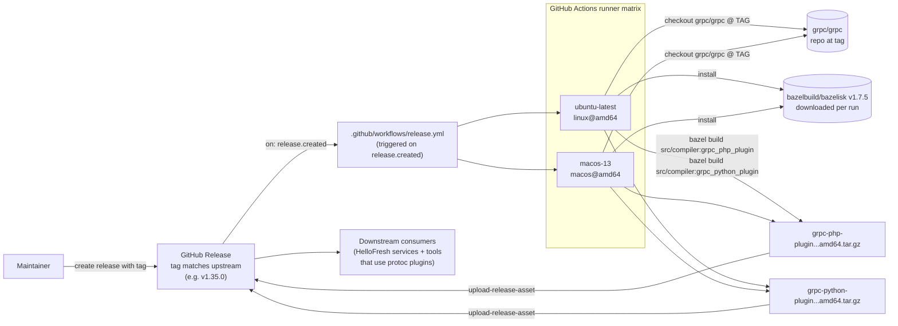
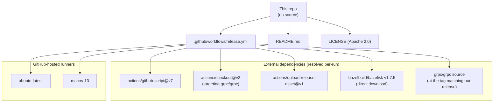
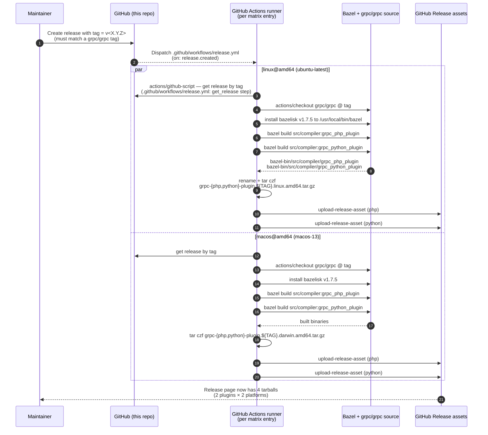
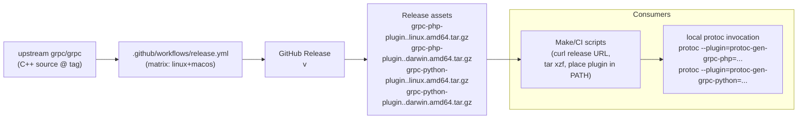

# Engineer Onboarding Guide

A guided tour of the `grpc-protoc-plugins` repository for a mid-to-senior engineer who has not worked on it before. Every claim below is anchored to a concrete file path. The existing high-level overview lives in [`README.md`](../README.md); this document complements it with diagrams and a CI/release deep dive.

> **TL;DR** — This repo does **not** contain source code. It is a thin **build-and-publish wrapper** around the upstream [`grpc/grpc`](https://github.com/grpc/grpc) project. A single GitHub Actions workflow ([`.github/workflows/release.yml`](../.github/workflows/release.yml)) checks out the upstream gRPC source at the tag matching our GitHub Release, builds two C++ protoc plugins (`grpc_php_plugin`, `grpc_python_plugin`) for Linux and macOS, and attaches the resulting tarballs to the same Release.

---

## Overview & Purpose

The `grpc/grpc` project does not ship pre-built `protoc` plugin binaries for PHP, and treats the Python plugin as something you should consume via `python -m grpc_tools.protoc` rather than as a standalone binary. HelloFresh's tooling (and other projects that wire `protoc` into Makefiles / CI) prefers a downloadable binary.

This repo exists to fill that gap. It is intentionally minimal:

- It has **no source code** — gRPC's official C++ source under [`grpc/grpc`](https://github.com/grpc/grpc) is the only thing being compiled.
- The version contract is "**our GitHub Release tag must match an existing upstream gRPC tag** (e.g. `v1.35.0`)". The pipeline takes care of the rest.
- Outputs are tarballs published as **release assets**, named `grpc-php-plugin.<TAG>.<platform>.amd64.tar.gz` and `grpc-python-plugin.<TAG>.<platform>.amd64.tar.gz` for `linux` and `darwin`.

References:
- Repo overview: [`README.md`](../README.md)
- Build pipeline: [`.github/workflows/release.yml`](../.github/workflows/release.yml)
- License: [`LICENSE`](../LICENSE) (Apache 2.0)

---

## Tech Stack

The repo's "stack" is essentially the build environment that the GitHub Actions workflow assembles on a runner per release.

| Concern | Choice | Where it shows up |
|---|---|---|
| Source of truth | Upstream `grpc/grpc` C++ source | [`.github/workflows/release.yml`](../.github/workflows/release.yml) `actions/checkout` step (`repository: grpc/grpc`, `ref: ${{ release tag }}`) |
| Build system | [Bazel](https://bazel.build/), via [Bazelisk](https://github.com/bazelbuild/bazelisk) v1.7.5 | [`.github/workflows/release.yml`](../.github/workflows/release.yml) "Install Basilisk" step |
| Targets built | `src/compiler:grpc_php_plugin`, `src/compiler:grpc_python_plugin` (Bazel labels in upstream gRPC) | [`.github/workflows/release.yml`](../.github/workflows/release.yml) "Build grpc_php_plugin and grpc_pyhon_plugin" step |
| Output platforms | `linux@amd64` (ubuntu-latest) and `macos@amd64` (macos-13) | matrix in [`.github/workflows/release.yml`](../.github/workflows/release.yml) |
| Artifact format | `tar.gz` (gzip) | "Archive artifacts" step in [`.github/workflows/release.yml`](../.github/workflows/release.yml) |
| Distribution | GitHub Release assets, attached via `actions/upload-release-asset@v1` | "Upload Release Asset for grpc_*" steps in [`.github/workflows/release.yml`](../.github/workflows/release.yml) |
| Trigger | GitHub Release `created` event | `on.release.types: [created]` in [`.github/workflows/release.yml`](../.github/workflows/release.yml) |
| License | Apache 2.0 | [`LICENSE`](../LICENSE) |

There is **no language toolchain checked into the repo** — no `go.mod`, `package.json`, `pyproject.toml`, `Makefile`, etc. Everything lives in CI.

---

## Architecture

### High-level architecture



### Module / dependency diagram

There are no modules in the traditional sense. Treat this as a "what the workflow depends on" view:



### Primary release-flow sequence



### Deployment / distribution diagram



There is no service to deploy. "Deployment" = creating the GitHub Release.

---

## Key Modules

The repo only has three top-level files; calling them "modules" is generous, but here is what each does:

- **[`.github/workflows/release.yml`](../.github/workflows/release.yml)** — the entirety of the build and release logic. It defines:
    - A `release.types: [created]` trigger.
    - A 2-entry `matrix` covering `ubuntu-latest`/`linux` and `macos-13`/`darwin`.
    - Six steps per matrix entry:
        1. `get_release` — uses `actions/github-script@v7` to look up the release by tag and surface the upload URL and tag name to subsequent steps.
        2. `Checkout` — uses `actions/checkout@v2` against `grpc/grpc` at the same tag.
        3. `Install Basilisk` — downloads `bazelisk-<platform>-amd64` v1.7.5 and installs it as `/usr/local/bin/bazel`.
        4. `Build grpc_php_plugin and grpc_pyhon_plugin` — `bazel build src/compiler:grpc_php_plugin` and `src/compiler:grpc_python_plugin`.
        5. `Archive artifacts` — copies `bazel-bin/src/compiler/grpc_php_plugin` to `grpc-php-plugin`, `tar czf` to `grpc-php-plugin.${VERSION}.<platform>.amd64.tar.gz`; same for the Python plugin.
        6. `Upload Release Asset` (twice) — `actions/upload-release-asset@v1` to the URL surfaced in step 1, using `${{ secrets.GITHUB_TOKEN }}`.
- **[`README.md`](../README.md)** — explains *why* the repo exists, references upstream gRPC docs, and outlines the workflow at a high level.
- **[`LICENSE`](../LICENSE)** — Apache License 2.0. The repo points to the [upstream `grpc-php-plugin` license](https://github.com/hellofresh/grpc-php-plugin/blob/master/LICENSE) as well; derived works keep their own licenses.

> Notable: there is no `.gitignore`, no language manifest, no `Makefile`. Everything outside CI is documentation and license.

---

## Data Flow

Because there is no runtime service, "data flow" describes the artifact pipeline:

1. **Trigger.** A maintainer creates a GitHub Release with a tag that exists in upstream `grpc/grpc` (e.g. `v1.35.0`). See [`README.md`](../README.md) "How it works" and the `on:` block at the top of [`.github/workflows/release.yml`](../.github/workflows/release.yml).
2. **Resolve release context.** The first step of the workflow uses `actions/github-script@v7` to call `repos.getReleaseByTag`, capturing `upload_url` and `tag` as step outputs ([`.github/workflows/release.yml`](../.github/workflows/release.yml) `get_release` step).
3. **Fetch upstream source.** `actions/checkout@v2` is invoked with `repository: grpc/grpc` and `ref: ${{ steps.get_release.outputs.tag }}`, populating the workspace with the gRPC C++ tree at the corresponding tag.
4. **Bootstrap Bazel.** Bazelisk v1.7.5 is downloaded directly from `bazelbuild/bazelisk` and installed as `/usr/local/bin/bazel` (so subsequent `bazel ...` commands are actually `bazelisk`, which downloads the version of Bazel pinned by upstream).
5. **Build.** Two Bazel targets are built: `src/compiler:grpc_php_plugin` and `src/compiler:grpc_python_plugin`. Outputs land under `bazel-bin/src/compiler/`.
6. **Archive.** Each binary is renamed to dash-cased form (`grpc-php-plugin`, `grpc-python-plugin`) and `tar czf`'d to `grpc-<lang>-plugin.<TAG>.<platform>.amd64.tar.gz`.
7. **Publish.** Each tarball is uploaded as a release asset via `actions/upload-release-asset@v1` using the URL from step 2 and the auto-injected `GITHUB_TOKEN`.

Consumer side (out of scope for this repo, but worth knowing): downstream tooling pulls assets directly from the GitHub Release URL pattern `https://github.com/hellofresh/grpc-protoc-plugins/releases/download/<TAG>/<asset-name>`.

---

## Local Dev Setup

Because all the work happens in CI, there is no "run the project locally" target. There are two realistic local-dev scenarios:

### 1. Edit the workflow / docs

```bash
git clone git@github.com:hellofresh/grpc-protoc-plugins.git
cd grpc-protoc-plugins
# edit .github/workflows/release.yml or README.md as needed
```

Validation tips:

- Validate YAML syntax: `yamllint .github/workflows/release.yml` (any common YAML linter works).
- For semantic checks of GitHub Actions, [`act`](https://github.com/nektos/act) can simulate the `release` event locally, but mind the macOS matrix entry (it requires a darwin runner image which `act` does not bundle by default).

### 2. Reproduce a build locally

If you need to reproduce a single plugin build without going through CI:

```bash
# pick a gRPC tag
TAG=v1.35.0

# get upstream gRPC at the tag
git clone --depth 1 --branch "$TAG" https://github.com/grpc/grpc.git
cd grpc

# install bazelisk (the workflow uses v1.7.5 — newer is fine for ad-hoc local builds)
brew install bazelisk      # or `npm i -g @bazel/bazelisk`, or download from bazelbuild/bazelisk

# build the same targets the workflow builds
bazel build src/compiler:grpc_php_plugin
bazel build src/compiler:grpc_python_plugin

# binaries land in bazel-bin/src/compiler/
ls -lh bazel-bin/src/compiler/grpc_php_plugin bazel-bin/src/compiler/grpc_python_plugin
```

Note: gRPC's Bazel build pulls in C++ toolchains and a sizable dep tree — first builds can take 15–30 min. macOS-arm64 may need extra flags; the CI workflow only ever ran `linux/amd64` and `darwin/amd64` ([`.github/workflows/release.yml`](../.github/workflows/release.yml) matrix). If you need ARM, see merged PR [#6 "Feature/pccs 11868 add arm support"](https://github.com/hellofresh/grpc-protoc-plugins/pull/6) (and check whether it was actually shipped — the matrix in the workflow is still `amd64`-only at the time of writing).

---

## Testing

The repo has **no automated tests**. There is no `test` directory, no test workflow, and no CI step beyond the build itself. Practical confidence checks:

- **Workflow syntax**: GitHub will validate the YAML on push; you can also run a YAML linter locally.
- **Dry-run a release**: create a draft release with a non-production tag (e.g. `vX.Y.Z-rc.1`) — but only if that tag also exists upstream in `grpc/grpc`. If you push the release, the workflow will run and you can inspect the resulting tarballs without affecting prod consumers.
- **Verify produced binaries**: extract a tarball and run `protoc --plugin=protoc-gen-grpc-php=./grpc-php-plugin --grpc-php_out=. some.proto` against a sample proto; same for Python with `--grpc-python_out=`.

If you want CI tests in the future, the natural place to add them would be a separate `pull_request` workflow that runs the same `bazel build` steps without uploading.

---

## Deployment

**There is no service to deploy.** "Deploying" this repo means **publishing a new GitHub Release** so consumers can pull the resulting plugin binaries.

### Release procedure

1. Find the upstream `grpc/grpc` tag you want to ship. Tags live at <https://github.com/grpc/grpc/releases>.
2. In this repo, **create a new GitHub Release with the same tag** (e.g. `v1.35.0`). You can do this via:
    - The GitHub UI (`Releases` → `Draft a new release`).
    - `gh release create v1.35.0 --title "v1.35.0" --notes "Tracks upstream grpc/grpc v1.35.0"`.
3. As soon as the release is created (`release.created` event), [`.github/workflows/release.yml`](../.github/workflows/release.yml) runs in two parallel matrix jobs.
4. Wait for both jobs to finish (Bazel C++ builds are slow — expect ~15–30 minutes per platform).
5. The release page should now show four assets:
    - `grpc-php-plugin.v1.35.0.linux.amd64.tar.gz`
    - `grpc-php-plugin.v1.35.0.darwin.amd64.tar.gz`
    - `grpc-python-plugin.v1.35.0.linux.amd64.tar.gz`
    - `grpc-python-plugin.v1.35.0.darwin.amd64.tar.gz`
6. Communicate to downstream consumers (HelloFresh services that pin a specific plugin version) that a new tag is available.

### What can go wrong (and where to look)

| Symptom | Likely cause | Where to look |
|---|---|---|
| Workflow fails at `Checkout` step | The tag does not exist upstream in `grpc/grpc` | upstream tag list at <https://github.com/grpc/grpc/releases> |
| Bazel build fails on macOS | Newer gRPC versions sometimes require Xcode updates not available on `macos-13` | matrix in [`.github/workflows/release.yml`](../.github/workflows/release.yml) — bumping to `macos-latest` may help |
| `upload-release-asset` fails with "release not found" | Race between release creation and the workflow's first step | re-run the workflow once the release is fully visible |
| `bazelisk` 404 | The hardcoded v1.7.5 download URL is dead | bump the URL/version in the "Install Basilisk" step of [`.github/workflows/release.yml`](../.github/workflows/release.yml) |

### Notes on history

- ARM support was attempted in PR [#6](https://github.com/hellofresh/grpc-protoc-plugins/pull/6) ("Feature/pccs 11868 add arm support"). The current workflow on `master` still only ships `amd64` for both platforms; if you need `arm64`, validate the matrix before promising it to consumers.

---

## Where to look next

- The full `release.created` flow is in [`.github/workflows/release.yml`](../.github/workflows/release.yml) — start there for any change to the build.
- Upstream gRPC C++ source is at [`grpc/grpc`](https://github.com/grpc/grpc); the plugin sources are under `src/compiler/` (Bazel labels `src/compiler:grpc_php_plugin`, `src/compiler:grpc_python_plugin`).
- License terms: [`LICENSE`](../LICENSE) — Apache 2.0.
- Upstream PHP plugin docs (referenced in the README): <https://grpc.io/docs/languages/php/quickstart/#php-protoc-plugin>.
- Upstream Python tooling docs: <https://grpc.io/docs/languages/python/quickstart/#grpc-tools>.
